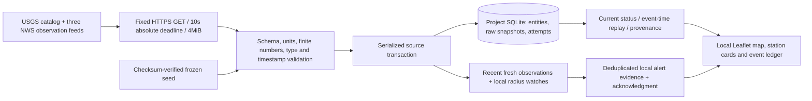

# Architecture

`app/fetch.py` uses one fresh AsyncClient per request, no inherited proxies/cookies/authentication, HTTPS publisher allowlist, same-host redirects, identity encoding and an absolute asyncio deadline over connection, headers, redirects and raw streaming. Runtime targets are canonical fixed constants, independent of optional seed files. No source scripts execute.

`app/parse.py` treats downloaded JSON as untrusted. Type, finite numeric values, coordinate bounds, epoch limits and supported measurement units are checked before any writes. Unsupported units remain missing; malformed unit structures fail the source. `app/store.py` serializes complete operations with a reentrant lock around one SQLite connection. Each source applies atomically; monotonic event update times reject older revisions. Weather identity is station/report time; capture time orders corrections to the same report. Original raw bytes, digest and retrieval/provider timestamps are retained separately from entity history.

A lifespan-owned polling thread sleeps between bounded refreshes, shares a single-flight/cooldown gate with manual requests, and joins before database close. Errors preserve last-good entities. Unexpected poll failures remain visible in health status and can recover on the next cycle. Restart seeds only missing sources, preserving newer persisted state and freshness. Acknowledgment, watches and alert identity survive restarts.

Every HTTP route has loopback Host protection. Browser mutations require same origin and reject cross-site fetch metadata. An ASGI middleware bounds chunked bodies before parsing. SQL values are parameterized, browser strings use textContent and source links have publisher allowlists. CSP, no-store, nosniff and no-referrer headers protect the local interface. There is no authentication layer; this is a single-user localhost service, and local processes can access it.
